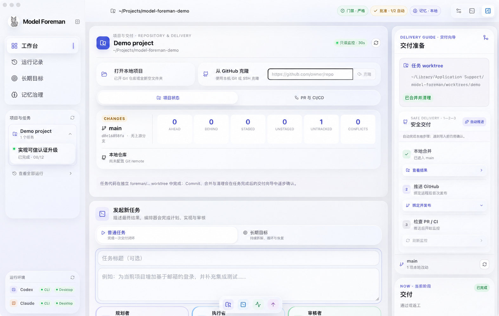
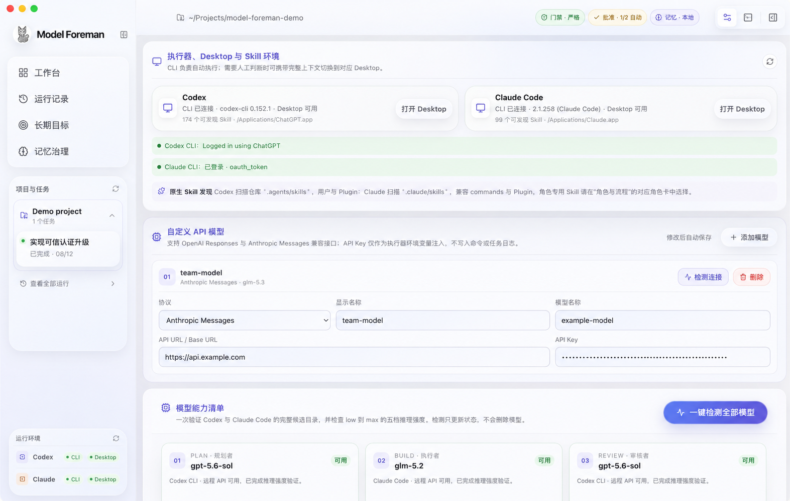

<p align="center">
  
</p>

<h1 align="center">Model Foreman</h1>

<p align="center">
  从目标到交付，每一步都有证据。<br>
  本地优先的多模型开发编排与安全交付工作台。
</p>

<p align="center">
  <a href="https://model-foreman.jiachengz135.chatgpt.site">产品官网</a> ·
  <a href="https://model-foreman.jiachengz135.chatgpt.site/guide">使用指南</a> ·
  <a href="https://github.com/zhoujiacheng1031/Model-Foreman/releases/latest">下载安装</a>
</p>

<p align="center"><strong>v0.5.5</strong> · macOS Apple Silicon · Windows x64</p>



## 一条可审核的开发流水线

Model Foreman 把三个模型角色和真实工程门禁串在一起：规划者生成执行合同，执行者在隔离 worktree 中修改代码，审核者依据 Diff 与验证证据决定是否交付。关键步骤始终由你批准。

| 01 规划 | 02 隔离执行 | 03 本地验证 | 04 人工批准 |
| --- | --- | --- | --- |
| 将目标拆成可检查步骤 | 不触碰当前工作目录 | 运行真实 lint、测试与构建 | 查看证据后再合并 |

## 真实界面

<table>
  <tr>
    <td width="50%"><strong>描述目标</strong><br><sub>普通任务与长期目标使用一致的任务入口。</sub></td>
    <td width="50%"><strong>配置角色</strong><br><sub>分别选择规划、执行和审核模型。</sub></td>
  </tr>
  <tr>
    <td></td>
    <td></td>
  </tr>
  <tr>
    <td colspan="2"><strong>接入模型</strong><br><sub>支持 OpenAI Responses、Anthropic Messages 兼容接口与连接检测。</sub></td>
  </tr>
  <tr>
    <td colspan="2"></td>
  </tr>
</table>

## 核心能力

- **多模型编排**：独立配置 Planner、Implementer、Reviewer 的执行器、模型、推理强度和 Skills。
- **自定义模型**：配置协议、Base URL、API Key 与模型名称，并在保存前检测连通性。
- **安全工作区**：每个任务使用独立 Git 分支与 worktree；规划和审核保持只读。
- **证据化交付**：展示统一 Diff、验证命令、退出码、Token、费用和完整事件记录。
- **可恢复运行**：支持暂停、恢复、返工、长期目标、预算限制和应用重启后的检查点恢复。
- **长期记忆**：仅从审核通过且成功合并的任务生成候选，并保留来源与重新验证状态。

## 快速开始

1. 从 [Releases](https://github.com/zhoujiacheng1031/Model-Foreman/releases/latest) 下载对应平台的安装包。
2. 安装并登录 Codex CLI 或 Claude Code CLI。
3. 在工作台打开本地仓库、空目录，或从 GitHub 克隆项目。
4. 配置三个角色，描述目标，审核计划后批准执行。
5. 检查验证证据与 Diff，再通过交付向导完成合并。

## 本地开发

需要 Node.js 22+，以及至少一种本地执行器：`codex` 或 `claude`。

```bash
npm install
npm run dev
```

```bash
npm run typecheck
npm test
npm run build
npm run package
```

macOS 对外发布需要签名与公证；完整说明见 [macOS 签名与公证](docs/macos-signing-notarization.md)。

## 安全边界

- 默认复用本地 CLI 登录状态，不把凭据写入仓库。
- 自定义 API Key 仅保存在本机，并通过子进程环境变量注入。
- Commit 与 Push 均要求预览和一次性确认；不会自动 force push。
- `.env*`、证书、数据库、运行日志和构建包由 `.gitignore` 排除。

## 进一步了解

- [产品使用指南](https://model-foreman.jiachengz135.chatgpt.site/guide)
- [macOS 签名、公证与分发](docs/macos-signing-notarization.md)
- [TencentDB Agent Memory 评估](docs/research/tencentdb-agent-memory-evaluation.md)

Model Foreman 仍在持续迭代。欢迎通过 [Issues](https://github.com/zhoujiacheng1031/Model-Foreman/issues) 提交问题与建议。
