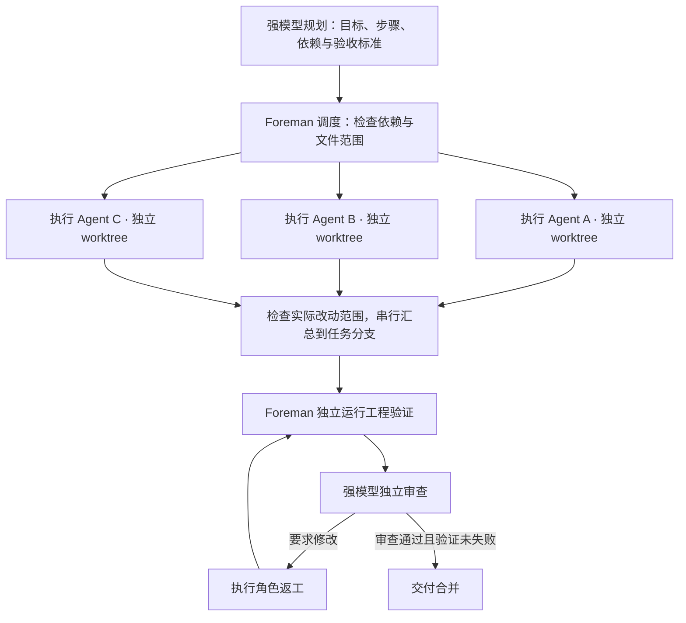
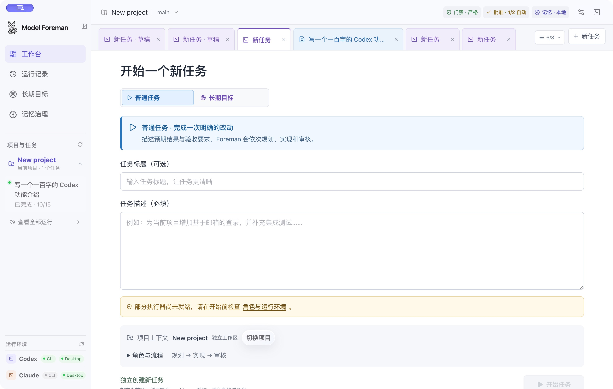

<p align="center">
  
</p>

<h1 align="center">Model Foreman</h1>

<p align="center">
  <strong>强模型规划与审查，多 Agent 并行执行。</strong><br>
  将不同模型与编码 Agent 编排为一条可验证、可恢复的开发流水线。
</p>

<p align="center">
  <a href="https://model-foreman.jiachengz135.chatgpt.site">产品官网</a> ·
  <a href="https://model-foreman.jiachengz135.chatgpt.site/guide">使用指南</a> ·
  <a href="https://github.com/zhoujiacheng1031/Model-Foreman/releases/tag/v1.0.0">下载 v1.0.0</a>
</p>

<p align="center">macOS Apple Silicon · Windows x64</p>

Model Foreman 是本地优先的多模型、跨 Agent 开发编排工具。你可以让强模型负责理解目标、拆解任务与独立审查，让多个执行 Agent 按计划并行实现，再由 Foreman 汇总代码、运行工程验证，并将证据交给审查模型判断是否交付。

规划、执行和审查可以使用不同的模型与执行器，各自配置推理强度、提示词和 Skill。Foreman 负责它们之间的任务分配、上下文传递、依赖调度、结果汇总与运行恢复。

## 强模型把关：先规划，再执行，独立审查

把复杂目标交给规划模型，得到一份可检查的**执行合同**：每一步要做什么、允许修改哪些文件、依赖哪些步骤、用什么标准验收。执行 Agent 按合同工作，审查模型依据实际代码与验证证据给出结论。

| 角色 | 职责 | 交给下一阶段的内容 |
| --- | --- | --- |
| Planner · 规划 | 检查仓库，拆解目标，识别假设、风险与依赖 | 步骤、文件范围、验收标准和验证命令 |
| Implementer · 执行 | 按步骤修改代码，可由多个 Agent 并行承担 | 实际改动、执行命令和未解决事项 |
| Foreman · 验证 | 独立运行配置的 lint、测试和构建命令 | 退出码、日志及验证结果 |
| Reviewer · 审查 | 独立检查需求符合度、Git Diff 和验证证据 | 通过、要求修改或阻塞，以及具体问题和依据 |

规划与审查的批准策略可分别配置：由你确认，或按模型置信度阈值自动处理。需要修改时，执行角色依据审查意见与验证报告返工，再次进入验证和审查，受最大审查轮数约束。验证失败会阻止任务通过；跳过验证会明确保留在证据中。

## 按依赖调度，让多个 Agent 并行实现

Foreman 将执行合同转成有依赖关系的步骤，按照文件范围选择可以同时运行的工作。单个任务支持最多 **4 个并行执行 Agent**，默认串行；执行成员可分别配置不同的模型和执行器。



- **依赖驱动**：无依赖且文件范围不重叠的步骤可以并行；依赖尚未完成、涉及同一文件或父子目录的步骤按顺序执行。未声明文件范围的步骤独占调度。
- **独立工作区**：每个步骤使用独立 Git 分支与 worktree，保留自己的执行记录、报告和提交。
- **依据真实改动汇总**：检查 Git Diff 与未跟踪文件是否超出批准范围，合格产出再依次合入任务分支，最后对汇总结果统一验证与审查。
- **保留失败证据**：同批 Agent 失败会停止该批执行并阻止交付；汇总冲突保留工作区和错误信息，供检查与恢复。

可以把前端、后端等独立工作分给不同执行成员；接口契约或共享资源有前后依赖时，必须在规划中声明。当前并行上限按单个任务计算，审查后的返工由主执行角色串行处理。

## 跨 Agent 编排：统一合同、上下文与结果

支持 **Codex CLI、Claude Code**，以及通过现有 CLI 适配层使用 **OpenAI Responses / Anthropic Messages 兼容 API** 的自定义模型。可以由一种执行器规划、另一种执行器实现，再由独立配置的模型审查；同一任务的并行执行成员也可以混用这些执行器。

Foreman 在这些执行器之间维护统一的工作约定：

- **结构化交接**：规划输出执行合同，执行返回实现报告，审查返回裁决与问题清单；解析校验后再推进阶段。
- **按依赖传递上下文**：执行 Agent 获得自己的过程记录，以及直接依赖中已汇总步骤的报告；保存最近一次调用实际使用的记忆快照，便于追溯。
- **统一运行管理**：记录各阶段与 Agent 的状态、日志、Token、费用和耗时；支持暂停、检查点恢复及失败后重试。
- **统一交付证据**：将代码变更、验证报告与审查结论关联到同一任务，再通过交付流程合并。

跨 Agent 的共享内容由 Foreman 管理，以任务合同、报告和经过筛选的记忆为单位；各 CLI 的私有会话历史不做双向同步。

## Memory：让可复用经验跨任务传递

记忆参与规划、执行与审查的上下文构建。默认使用本地 **SQLite + FTS5**，围绕项目、角色、来源与审批状态管理经验。

| 层次 | 保存什么 | 如何使用 |
| --- | --- | --- |
| 任务内工作记忆 | 当前 Agent 的过程记录、直接依赖步骤的已汇总报告 | 帮助后续步骤接续工作，明确标注为过程记录 |
| 项目长期记忆 | 有来源的事实、决策、约束、流程与评审经验 | 检索已批准条目，按角色类型与上下文预算筛选后注入 |

审核通过且已合并的交付，可从有证据的评审发现中提取经验候选，默认需要批准后才供后续任务使用。记忆绑定来源任务、提交和相关文件；后续交付修改相关代码时标记为待重新验证，审批与版本替代保留一致性检查。

并行执行时还会核对记忆来源提交是否属于 Agent 的基准历史，避免将尚未合入该分支的知识作为已知事实。注入的记忆保留来源，并明确要求以当前用户指令和仓库现状为准。

### 可选接入 TencentDB Agent Memory

已提供 **TencentDB Agent Memory Core v3** 的连接检测与检索适配，可在本地记忆之外配置外部检索服务。项目归属、审批状态和来源校验仍由 Foreman 管理。

当前外部命中必须与本项目已批准本地副本的来源标识和内容匹配，才可参与上下文注入；远端独有记忆暂不注入，尚未提供远端导入审批或自动双向同步。外部检索不可用时继续使用本地记忆。

更多机制与接入边界见 [并行执行与记忆治理](docs/architecture/parallel-agents-memory.md) 和 [TencentDB Agent Memory 设计评估](docs/research/tencentdb-agent-memory-evaluation.md)。

## 从一次任务到长期目标

普通任务适合一次明确的功能、修复或文档改动。长期目标将成功标准组织成有依赖的子任务，复用同一套规划、执行、验证、审查和交付流程，按完成证据推进后续工作。

长期目标支持时间、Token、费用与循环次数预算，保留子任务和运行记录；遇到阻塞或工作区变化时暂停推进或要求重新验证。费用按执行器报告的用量统计，正在进行的调用可能超出预算。

<details>
<summary>查看真实应用界面</summary>



</details>

## 安装与快速开始

[1.0.0 Release](https://github.com/zhoujiacheng1031/Model-Foreman/releases/tag/v1.0.0) 提供 macOS Apple Silicon（DMG）和 Windows x64（EXE）安装包，以及 SHA-256 校验文件。双平台 CI 构建与包内版本检查已通过；Windows 安装和界面尚未进行人工验收。

macOS 安装包使用临时签名、尚未公证；首次打开可能需要在“系统设置 → 隐私与安全性”中选择“仍要打开”。Windows 安装程序未配置商业代码签名证书，SmartScreen 可能显示来源提示。

1. 安装对应平台的已发布安装包，或按下方说明从源码运行。
2. 安装并登录所用的 Codex CLI 或 Claude Code CLI，在“设置 → 运行环境”检查状态。
3. 打开本地 Git 仓库、空目录，或从 GitHub 克隆项目。
4. 配置角色与模型，点击“新任务”，选择普通任务或长期目标并填写目标。
5. 按批准策略检查计划、验证结果与 Diff，通过交付向导完成合并。

## 本地开发与打包

需要 Node.js 22+、Git，以及所用的本地执行器。

```bash
npm install
npm run dev
```

验证源码：

```bash
npm run typecheck
npm test
npm run build
```

生成本机安装包：

```bash
# macOS Apple Silicon 本地测试包，临时签名、未公证
npm run dist:mac:adhoc

# Windows x64 安装包，需要对应构建环境
npm run dist:win
```

macOS 正式分发的签名、公证与验包说明见 [macOS 签名与公证](docs/macos-signing-notarization.md)。

## 安全边界

- 复用本地 CLI 登录状态；自定义 API Key 保存在本机，通过执行器环境变量注入，不写入命令或任务日志。
- Git 分支与 worktree 用于协作隔离，不是操作系统安全沙箱；执行器仍可能访问本机凭据和共享服务。
- 验证结论取决于实际运行的命令；跳过验证不等于测试通过。
- 产品中的 Commit 与 Push 提供预览和确认，不自动 force push。
- `.env*`、证书、数据库、运行日志和构建包由 `.gitignore` 排除。

## 进一步了解

- [产品使用指南](https://model-foreman.jiachengz135.chatgpt.site/guide)
- [并行执行与记忆治理](docs/architecture/parallel-agents-memory.md)
- [macOS 签名、公证与分发](docs/macos-signing-notarization.md)
- [TencentDB Agent Memory 评估](docs/research/tencentdb-agent-memory-evaluation.md)
- [提交问题与建议](https://github.com/zhoujiacheng1031/Model-Foreman/issues)
