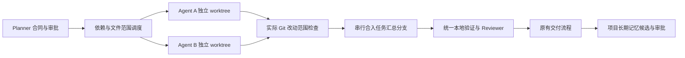

# Model Foreman 并行执行与记忆治理

实施日期：2026-09-07，版本 0.5.6。第一阶段作为 Model Foreman 内部能力交付，继续使用 Electron、TypeScript、React、node:sqlite 和 Git；没有引入独立服务、向量数据库或新的 npm 依赖。

## 使用

1. 在设置的角色流程中找到「并行执行 Agent」，将并行数从默认的 1 调整为 2–4。
2. 可添加执行成员，分别选择 Codex CLI、Claude Code 或现有自定义 API 适配器及模型。不添加成员时使用执行角色的配置。设置保存后对新任务生效；任务创建时冻结成员配置。自定义 API 仍通过已有 CLI 适配层工作，并不新增 Grok 专用 harness。
3. 审批规划时检查每一步的依赖和文件范围。明确无依赖的步骤使用 `dependsOn: []`；旧合同缺少该字段时保留原有先后顺序。文件范围填写仓库相对文件或目录，不能用通配符。空范围表示独占工作区调度。
4. 独立、范围不重叠的步骤可以并行；同一文件、父子目录范围或依赖关系会使步骤串行。逻辑依赖也必须声明，不能仅凭文件不同判断独立。
5. 任务详情中的「Agent 工作记忆与执行状态」显示成员、步骤、工作区、提交、报告、错误和最近一次上下文快照。所有步骤汇总后走原有本地验证、Reviewer 和交付流程。返工暂由主执行角色串行处理。

并行上限按单个任务计算，不是全应用总限额。默认 1 和没有执行策略的历史任务继续使用原有串行流程。

## 执行边界

每个步骤有独立 AgentTask、分支、worktree、执行尝试和报告。进程使用独立 executionId 注册，按父任务取消所有所属进程；验证器同样按任务取消。日志包含 Agent 标识。调度状态持久化到 runs.agent_tasks，执行策略存于 runs.execution_policy。

Foreman 根据实际 Git diff 和未跟踪文件检查修改范围，不依赖模型自报的 filesChanged。合格产出自动提交到本地 Agent 分支，再串行 merge 到任务隔离分支。提交祖先关系用于判断是否已经汇总，避免崩溃恢复时重复合并。源工作目录继续通过原有交付流程处理。

一个 Agent 失败会停止同批进程，并阻止后续汇总与交付。成功或失败的 worktree 均保留到任务交付清理或显式丢弃；Agent 分支保留为恢复证据。汇总冲突尝试 abort，记录错误并保留产出。暂停或退出中断的任务可以复用原工作区恢复；失败任务沿用产品原来的「重试创建新任务」语义，不伪装成已经验证完成。

worktree 和范围检查是协作隔离，不是操作系统安全沙箱：Agent 仍可能使用相同端口、外部数据库、缓存或凭据。提示词要求只使用本工作区测试资源，共享服务需求应报告阻塞。需要不可信代码隔离或跨主机并行时，应进一步引入容器、资源租约和执行凭证；当前没有承诺这些能力。

## 记忆边界

- **任务内工作记忆**：每个 Agent 仅获得自己的过程记录和直接依赖中已汇总步骤的报告。无关兄弟 Agent 的未汇总报告不注入。工作记忆明确标注为过程记录，不等价于项目已验证事实。
- **调用快照**：保存最近一次调用实际使用的记忆文本、记忆 ID/版本/更新时间/来源提交、Agent 基准提交和快照时间。协议修复或恢复调用更新该快照，目前不是保存全部历史调用的不可变事件库。
- **项目长期记忆**：继续按项目、角色、审批状态和预算检索；并行 Agent 额外检查来源提交是否属于其基准历史。无法验证来源提交的记忆不注入该 Agent。暂停、失败、单个 Agent 成功或仅完成审核均不会直接产出长期知识；沿用整体交付已合并且审核通过的入口。
- **版本治理**：记忆审批使用 expectedVersion 乐观并发检查；审批、旧版本替代和状态审计在 SQLite 事务内完成。跨项目替代被拒绝。过期、来源文件变化的失效也递增版本。自动批准设置仍生效，但走同一版本转换路径。
- **外部来源**：TencentDB 检索分数不再直接代表本项目的批准事实。只有内容匹配的本地已批准副本才可作为来源；不合格命中在任务日志明确说明未注入。当前尚未提供远端记忆导入和项目归属审批界面，因此现有远端独有命中不会直接注入。后续应补来源映射与候选收件箱，不能恢复为按相关度直接信任。

版本审计表为 memory_audit；当前 UI 展示审批状态与工作快照，尚未提供审计历史浏览器。记忆删除沿用现有能力。跨 harness 的本地私有会话历史不做双向镜像，本期共享入口是 Foreman 控制的上下文和执行报告。

## 验证与后续

自动化测试覆盖真实临时 Git 仓库的并行执行、文件重叠串行、依赖汇总、越界修改拒绝、崩溃状态恢复、重复汇总幂等、冲突恢复，以及混合执行器的编排、任务范围进程和验证器取消、未合并来源过滤、审批版本冲突及自动替代。执行器混合场景使用测试替身，没有消耗真实 Codex/Claude 账户额度，也没有声称完成线上模型端到端验收。

完成此基线后，可依次增加：各 harness 实测矩阵与资源限额；追加式事件和全部调用快照；远端候选收件箱；按能力协商的 harness 接口和 MCP 查询入口。独立服务化应在 Foreman 的恢复、治理和使用数据稳定后进行，优先抽出上下文查询与候选写入接口，而不是迁移整个执行器。

Windows 取消使用系统 taskkill 终止指定进程树；独立验证通过 cmd.exe 执行。发布工作流在 Windows runner 验证 shell 后代终止，并分别生成双端产物。真实在线 harness 的端到端验收仍需单独执行。
